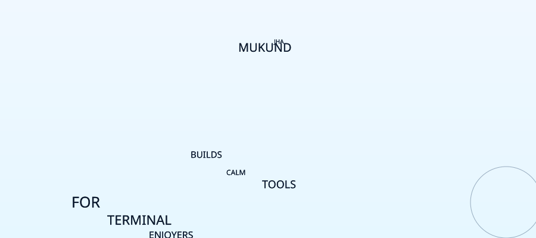

  <picture>
    <source media="(prefers-color-scheme: dark)" srcset="./hero/nebula-dark.svg">
    <source media="(prefers-color-scheme: light)" srcset="./hero/nebula-light.svg">
    
  </picture>

### selected work

- **[hazzel](https://github.com/mukundzha/hazzel)** — a terminal coding harness
- **[avouch](https://github.com/mukundzha/avouch)** — a cli-based static python code reviewer
- **[grass](https://github.com/mukundzha/grass)** — a calm, zero-config, minimal text editor
- **[golang-mini-projects](https://github.com/mukundzha/golang-mini-projects)** — learning go, one small project at a time

### elsewhere

[mail](mailto:mukundzha33@gmail.com) · [x](https://x.com/thwmjha) · [github](https://github.com/mukundzha)
